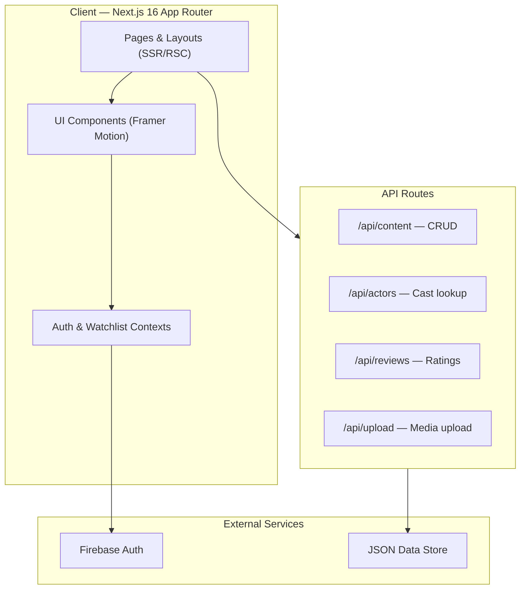

 BBC Studios — Premium Streaming Platform


A Netflix-style streaming entertainment platform built with **Next.js 16** (App Router, React Server Components), **Firebase** authentication & data, and **Framer Motion** animations. Features a full admin CMS, user profiles, watchlist, download manager, and content discovery engine.

## Architecture



## Features

- **Content Discovery** — Hero banner, trending carousel, genre grids, continue-watching row
- **Search & Filtering** — Modal search with category filters and sidebar facets
- **User System** — Sign up, login, email verification, profile settings, multi-profile support
- **Watchlist & Downloads** — Add to My List, simulated download manager with progress tracking
- **Content Detail** — Full content pages with enhanced video player, ratings/reviews, social sharing
- **Admin Dashboard** — Content CRUD, actor management, analytics, media upload
- **Actor Pages** — Dynamic actor profiles with filmography
- **Responsive UI** — Mobile-first design with Tailwind CSS, Geist font, skeleton loading states

## Project Structure

```
bbc-studios/
├── src/
│   ├── app/                    # Next.js App Router
│   │   ├── page.tsx            # Home — Hero + content grids
│   │   ├── movies/             # Movies browse page
│   │   ├── tv-shows/           # TV shows browse page
│   │   ├── content/[id]/       # Content detail page
│   │   ├── actors/[name]/      # Actor profile page
│   │   ├── my-list/            # User watchlist
│   │   ├── downloads/          # Download manager
│   │   ├── login/ & signup/    # Auth pages
│   │   ├── admin/              # Admin CMS (manage, upload, edit, analytics, actors)
│   │   └── api/                # REST API routes (content, actors, reviews, upload)
│   ├── components/             # Reusable UI (navbar, hero, grids, modals, player)
│   ├── contexts/               # React contexts (auth, watchlist)
│   └── lib/                    # Firebase config, utilities, download store
├── data/                       # JSON data files (content, actors, reviews)
├── public/                     # Static assets (favicon, SVGs)
└── package.json
```

## Quick Start

```bash
git clone https://github.com/Deeraj1606/bbc-studios.git
cd bbc-studios
npm install
npm run dev        # → http://localhost:3000
```

### Production Build

```bash
npm run build
npm start
```

## Tech Stack

| Layer | Technology |
|-------|-----------|
| Framework | Next.js 16 (App Router, Server Components) |
| Language | TypeScript 5 |
| Styling | Tailwind CSS 4, Geist font |
| Animation | Framer Motion |
| Auth | Firebase Authentication |
| Data | JSON files served via API routes |
| Charts | Recharts (admin analytics) |
| Icons | Lucide React |
| UI Primitives | CVA + clsx + tailwind-merge |

## License

MIT — see [LICENSE](LICENSE) for details.
